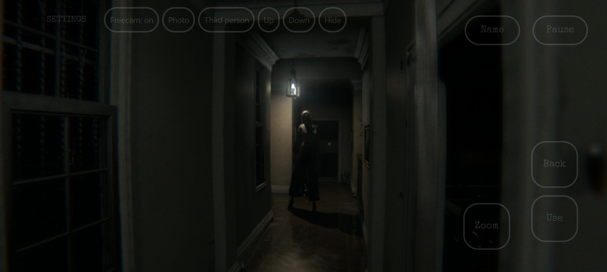
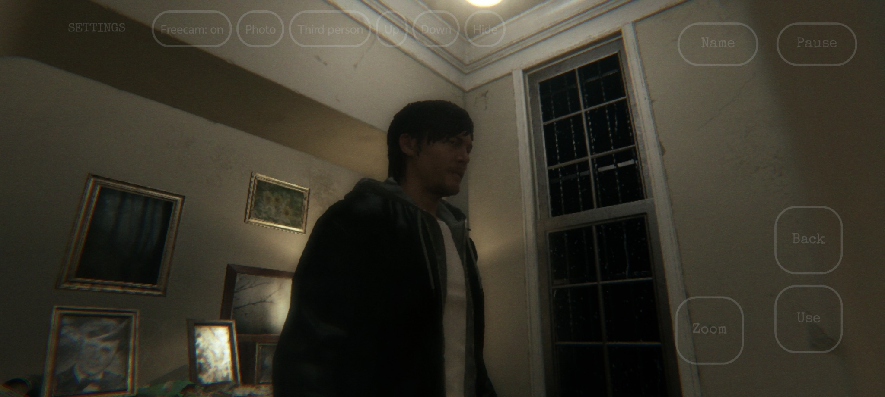
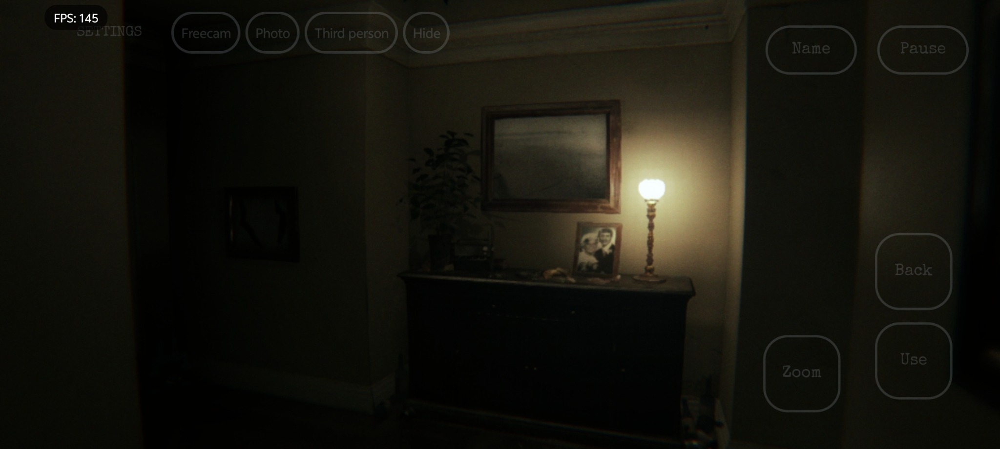
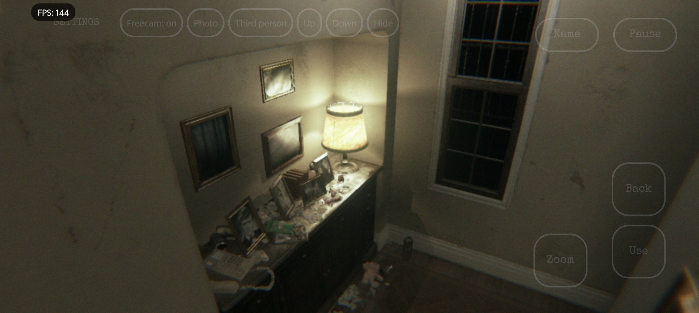
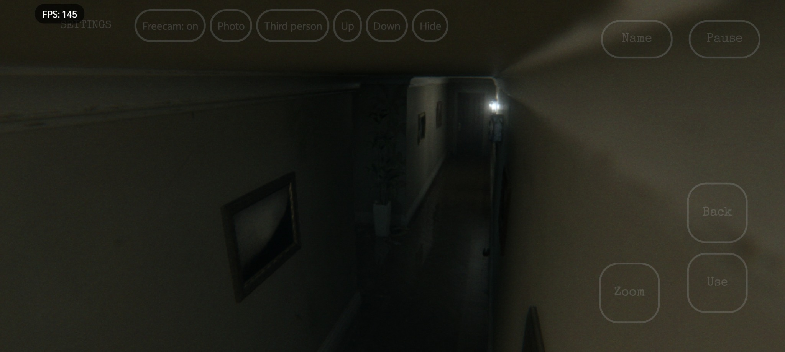
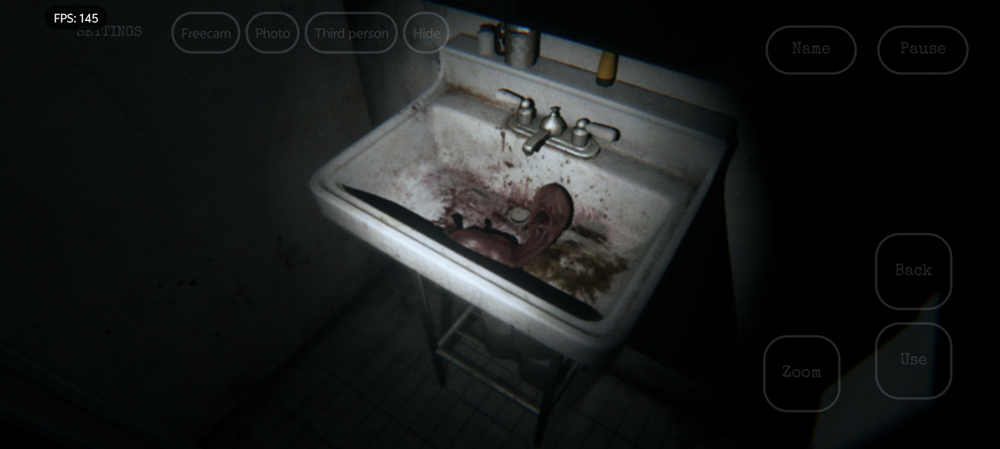

  <picture>
    <source media="(prefers-color-scheme: dark)" srcset="docs/images/pt4droid-logo.png">
    <source media="(prefers-color-scheme: light)" srcset="docs/images/pt4droid-logo-light.png">
    
  </picture>

<h1 align="center">pt4droid</h1>

  <strong>P.T. for Android</strong> 
  Maintained by <a href="https://github.com/XHYN-PH">XHYN-PH</a>

  <a href="https://github.com/XHYN-PH/pt4droid/releases/tag/pt4droid-v0.2.1-test.16">Download APK</a>
  &nbsp;·&nbsp;
  <a href="#screenshots">Screenshots</a>
  &nbsp;·&nbsp;
  <a href="#getting-started">Getting started</a>
  &nbsp;·&nbsp;
  <a href="https://github.com/XHYN-PH/pt4droid/issues">Report an issue</a>

---

Play **P.T. on Android** with customizable touch controls, controller support and graphics settings. Maintained by **XHYN-PH**.

**[Download Test 16](https://github.com/XHYN-PH/pt4droid/releases/tag/pt4droid-v0.2.1-test.16)** · Android 10+ · 64-bit phones

**Game files are not included.** You need your own P.T. game dump.

## Screenshots

  
  

  
  

  
  

## Getting started

1. Download **pt4droid-v0.2.1-test.16-arm64.apk** from the [release page](https://github.com/XHYN-PH/pt4droid/releases/tag/pt4droid-v0.2.1-test.16) and install it.
2. Open the app, tap **Choose your P.T. .pkg**, and select your game package.
3. Wait for the import to finish, then tap **Enter menu**.
4. Choose your settings and tap **Start**.

**Updating?** Install the new APK over the existing app to keep your game files, saves and settings. Avoid uninstalling first.

Game files and importing help

Use a game package made from your own P.T. dump. Extract ZIP, RAR or 7z archives first. Encrypted PlayStation Store packages cannot be imported.

If you already have extracted files, choose **I already have the extracted files**. Put these in Downloads, loose or inside a folder named `CUSA01127`, then allow storage access:

- `chunk1.psarc`
- `texture.qar`
- `pathid_list_ps4.bin`

The US game dump, **CUSA01127**, is the reference version. Allow about **1.4 GB** for the game files, plus space for the app and temporary files.

## Controls and settings

- **Move and look:** use the invisible movement area and swipe to look around. Adjust sensitivity in Settings.
- **Touch layout:** move, resize or hide buttons in **Settings → Controls → Customize touch layout** while playing.
- **Button visibility and vibration:** adjust these in **Settings → Controls**.
- **Graphics:** use **Settings → Game graphics**. Start with **Balanced**, or try **Maximum performance** if the game feels slow.
- **Camera and photos:** use the toolbar beside **Settings** for free camera, photo mode and third-person view. Tap **Hide** to fold it away. Photos appear in **Pictures/PT Photos**.
- **Return to menu:** open the in-game settings. **Delete saves** is available from the main menu only.

Controllers, keyboard and mouse are also supported. The ending supports microphone input; the touch **Name** button is also available.

## Compatibility

You need a compatible **64-bit Android 10+ phone** with **Vulkan 1.3** support. Performance varies by device. Mali and Xclipse support is experimental.

Start with the **Automatic** graphics driver. If a custom driver prevents the game from starting, tap **Retry with system driver** or choose **System Vulkan driver** in the launcher's **Settings → Graphics driver**, then restart.

Optional driver ZIPs are for matching devices only. Read their release-page descriptions before importing one.

## Need help?

[Report a problem](https://github.com/XHYN-PH/pt4droid/issues) with your phone model, Android version, app version and what happened.

To include logs, turn them on in **Settings → Performance & advanced**, tap **Apply**, and reproduce the problem. Use **Export diagnostics** on that page, then turn logs off afterwards.

## Credits

- **[XHYN-PH](https://github.com/XHYN-PH)** — pt4droid maintainer.
- **[LoreanXavier](https://github.com/LoreanXavier/pt-pc)** — original PC port. [Support the original project](https://patreon.com/loreanxavier).
- **[StoneColdOS](https://github.com/StoneColdOS/pt-pc)** — original Android port.

[Additional credits](docs/CREDITS.md) · [Build instructions](docs/android.md) · [MIT license](LICENSE)

P.T. and its artwork belong to their respective rights holders, including Konami and Kojima Productions. This is an unofficial port, with no affiliation or endorsement.
